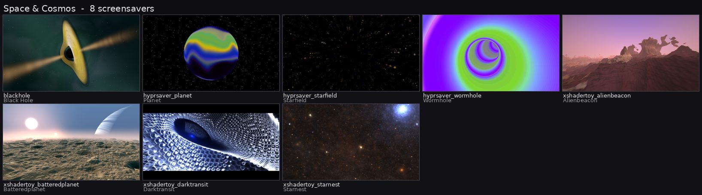

# ncz-screensavers

**74 screensaver programs that run natively on Wayland.** Each one is a
separate binary built on GLES 3.2 and EGL, drawing on a `zwlr_layer_shell_v1`
overlay surface. No X11, no Xwayland, no OpenGL 1 emulation layer.


One harness (`src/gles3_harness.c`) owns the Wayland connection, the layer
surface, the EGL context and the frame loop. The saver owns its GL objects
and its uniforms. A launcher picks a saver, builds its environment and
supervises it; an idle daemon starts it after the idle time you set.

| Origin group | Count | Examples |
|---|---|---|
| In-house engines | 3 | `blackhole_gles3`, `magmasimplex_gles3`, `fractasia_gles3` |
| In-house shaders | 1 | `xshadertoy_neonhorizon_gles3` |
| Ported classics | 11 | `voronoi_gles3`, `hypertorus_gles3`, `datatowers_gles3` |
| Ported hyprsaver shaders | 30 | `hyprsaver_aurora_gles3`, `hyprsaver_starfield_gles3` |
| Ported xshadertoy shaders | 30 | `xshadertoy_alienbeacon_gles3`, `xshadertoy_neongravity-1_gles3` |
| **Total shipped** | **74** | |

`xshadertoy_neonhorizon_gles3` is written in house *and* ships as one of
the thirty `xshadertoy_*` binaries, so the group table counts it once, in
the in-house row.



## Documentation

- **[docs/user-guide.md](docs/user-guide.md)** — turn it on, choose a saver,
  set the timers, try one out, fix what is broken.
- **[docs/savers.md](docs/savers.md)** — the catalogue index and how to read
  a row.
- **[docs/index.md](docs/index.md)** — every page.

The catalogue has one page per origin group, each row giving the name, a
one-line description, the style category, the minimum GPU class, the
options, and the author and licence from the saver's own source header:

| Page | Group |
|---|---|
| [docs/catalogue/in-house-engines.md](docs/catalogue/in-house-engines.md) | Black Hole, Magmasimplex, Fractasia |
| [docs/catalogue/in-house-shaders.md](docs/catalogue/in-house-shaders.md) | Neon Horizon |
| [docs/catalogue/ported-classics.md](docs/catalogue/ported-classics.md) | the eleven ported xscreensaver hacks |
| [docs/catalogue/hyprsaver.md](docs/catalogue/hyprsaver.md) | the thirty hyprsaver shaders |
| [docs/catalogue/xshadertoy.md](docs/catalogue/xshadertoy.md) | the thirty Shadertoy-API shaders |

## Install

| Where | Packages | Settings UI |
|---|---|---|
| NCZ-OS | `ncz-screensavers` + `ncz-screensavers-plugin` | Settings > Plugins > Screensaver and Lockscreen |
| Another GTK/libadwaita distribution | `ncz-screensavers` + `ncz-screensavers-gtk4-reference` | the reference GTK4 application |
| Another desktop | `ncz-screensavers` | a front end written against [docs/cli-reference.md](docs/cli-reference.md) |

The engine builds for `amd64` and `arm64`; see
[docs/packaging.md](docs/packaging.md).

## Lock-hosted saver

Since 0.8.11 the saver can run inside the session lock: `ncz-screensaver-feed`
renders a hack off-screen and hands frames to a lock client that hosts an
out-of-process frame source. The feed renders at 30 fps and full resolution by
default (15 fps on battery; 15 fps at half resolution on a weak GPU; never above
the display refresh rate; adjustable on the Screensaver and Lock page or in
`/etc/ncz/lock-renderer.env`) and keeps animating while nobody touches the
machine; it freezes on a frame only
when input raises the unlock prompt (the prompt is drawn over that frame), and
resumes if the prompt lowers again without an unlock (with a lock client that
supports it). A thermal governor pauses
rendering near 85 C until the system cools. The older intro-then-freeze timer is
an opt-in (`NCZ_SAVER_FREEZE=always`). `ncz-screensaver-feed --print-policy`
prints the policy; details in `docs/LAUNCHER-DESIGN.md` section 8.1. Release
notes: `CHANGELOG.md`.

## Build

```
meson setup build && ninja -C build && meson test -C build
```

Build options: `-Dinstall-extras=true|false` (also install the shaders of
the development-only savers), `-Dsingularity-plugin=enabled|disabled` (the
Singularity settings plugin) and `-Dgtk4-reference-app=true|false` (the
reference GTK4 front end). Packaging lives in `debian/`.

## Run one directly

```
blackhole_gles3 --help                    # the options of that saver
blackhole_gles3 --palette=cygnus          # run it with an option
hyprsaver_aurora_gles3 --render-scale=0.5 # the three options every saver has
voronoi_gles3 --style=enhanced --seed=42
```

Or through the launcher:

```
ncz-screensaver list                      # the catalogue
ncz-screensaver preview hyprsaver_wormhole
ncz-screensaver status --json
ncz-screensaver stop
```

The savers are in `src/`, the idle timer and the launcher in `launcher/`,
and the Singularity settings UI in `plugin/`.

## Licence

The project is Apache-2.0 (`LICENSE`, `NOTICE`), and that grant covers the
in-house code only: the harness, the drivers, the launcher, the idle timer,
the plugin, the tools and the in-house engines and shaders. Each screensaver
is a separate program, and every vendored or ported component keeps its own
licence and notice — MIT, CC0-1.0, CC-BY-3.0 or the xscreensaver permission
notice. The component-by-component record is `NOTICES.md`,
`debian/copyright`, `docs/PROVENANCE.tsv` and the per-saver credits in the
catalogue. See [docs/credits.md](docs/credits.md).