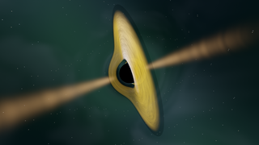
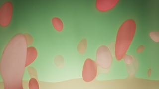
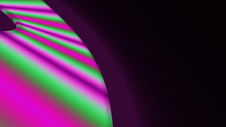

# Catalogue: in-house engines

Three engines written for this project. Each is a driver in `src/` plus its
own shaders in `vendor/<engine>/`, built as one binary per engine and driven
by the shared GLES3 harness. See
[`../architecture.md`](../architecture.md) for the harness and
[`../PALETTES.md`](../PALETTES.md) for the palette options.

| Name | Binary | Category | Tier | Licence | Credits |
|---|---|---|---|---|---|
| Black Hole | `blackhole` | Space | weak | MIT | Otto Seiskari; Adriwin (upstream); NCZ (port and rewrite) |
| Magmasimplex | `magmasimplex` | Abstract & Fluid | mid | Apache-2.0 | NCZ |
| Fractasia | `fractasia` | Fractals & Math | weak | Apache-2.0 (original) + MIT (four adapted families) | NCZ; Mara Vexa (`julia_glow`, `orbit_trap`, `mobius`, `ship_glow`) |

## Black Hole

**`blackhole_gles3`** — a ray-marched black hole: gravitational lensing of
a starfield, a lensed accretion disk with Doppler beaming and redshift, and
polar jets.

Origins and credits. The idea and the original shader come from
`Adriwin06/black-hole` (MIT, © Otto Seiskari), vendored under
`vendor/blackhole/` with its licence text at
`vendor/blackhole-LICENSE.txt`. The port to this engine was a heavy
rewrite; `PORTED.md` and `vendor/blackhole-PORTED.md` record what changed.
The saver is therefore MIT, not Apache-2.0.

Options: **55**, the largest surface in the catalogue. The schema is
`assets/screensaver-chooser/options/blackhole.tsv` and it is installed, so
the chooser and `ncz-screensaver list-options blackhole` show all of them.
The groups are:

| Group | Options |
|---|---|
| Preset and look | `preset`, `palette`, `cycle-palettes`, `palette-transition`, `cycle-interval`, `exposure`, `disk-brightness` |
| Scene | `scene`, `scene-quality`, `mass-ratio`, `separation`, `scene-cycle`, `ripples`, `lens` |
| Camera | `frame-x`, `frame-y`, `flyby`, `speed`, `distance-min`, `distance-max`, `inclination`, `duration` |
| Disk | `spin`, `rotation-speed`, `precession`, `temperature`, `disk-outer`, `jet-length`, `torus`, `companion`, `bloom`, `fringe`, `beaming`, `star-density`, `nebula`, `jet`, `hot-sector` |
| Style | `style`, `jet-duty`, `drift`, `photon-ring`, `bright-stars`, `tonemap`, `disk-structure`, `lensing` |
| Capture | `capture`, `capture-at`, `capture-frames`, `capture-fps`, `capture-size`, `capture-supersample`, `capture-steps` |
| Quality | `adaptive`, `quality`, `seed` |

`scene` selects `single` (default), `binary`, `merger`,
`tidal-disruption`, `galaxy-zoom` or `three-body`; `scene-quality` is
`auto`, `light` or `rich`. `style` is `classic` (default) or `enhanced`.
`flyby` is `auto` (default), `director`, `legacy`, `orbit`, `slow-orbit`,
`equatorial`, `polar`, `plunge`, `slingshot`, `drift` or `random`.

Presets. Black Hole ships named scenes as preset key files under
`assets/screensaver-chooser/options/presets/blackhole/`, catalogued with a
description and their own minimum GPU class in
`assets/screensaver-chooser/presets.tsv` (61 preset rows in 0.8.9, all of
them Black Hole and Magmasimplex). `blackhole_gles3 --list-presets` prints
them; `--preset=<name>` applies one.

Stills. Black Hole is the one saver with a capture mode, so
`ncz-screensaver still blackhole --out shot.png` renders one frame through
it with no window and prints the path.

## Magmasimplex

**`magmasimplex_gles3`** — a molten-wax lava lamp: a fluid simulation runs
on the GPU and is rendered as a chunky candle under a dark room.

Origin and credits: written for this project, Apache-2.0, driver in
`src/gles3_magmasimplex.c` with the simulation and pattern layers in
`src/magmasimplex_*.c` and the shaders in `vendor/magmasimplex/`.

Options: **36**, declared in
`assets/screensaver-chooser/options/magmasimplex.tsv` and installed. The
notable ones:

| Option | Default | Meaning |
|---|---|---|
| `engine` | `goo` | The simulation engine. |
| `preset` | empty | A named scene, from `options/presets/magmasimplex/`. |
| `randomize` | `auto` | Draw unset options from the seed. |
| `view`, `world`, `palette-era`, `palette`, `material`, `glitter` | `auto` | Look selection; `palette-era` narrows the palettes to `1960s`, `1970s`, `1980s`, `1990s` or `modern`. |
| `texture`, `glitter-amount`, `motes`, `glass`, `depth`, `drift` | 1 | Material and framing multipliers. |
| `kaleidoscope` | -1 | Symmetry fold count; -1 is off. |
| `chapter`, `speed`, `viscosity`, `heat`, `wax`, `cap` | varies | Simulation parameters. |
| `startup` | `false` | Warm the simulation up from a cold start. |
| `projector-mask`, `projector-mask-size`, `overlay` | `soft` | The projector look. |
| `dendrites`, `dendrite-strength` | `off`, 1 | Crystalline growth in the wax. |
| `poster` | `false` | Poster-art treatment. |
| `dynamics`, `tempo`, `audio` | 0, 0, `off` | Audio-reactive layer; capture needs `-Dmagma-audio=true` (the default) and a PulseAudio or PipeWire record tool. |
| `quality`, `seed`, `pattern-seed`, `colourway` | `auto`, 0, `auto`, -1 | Reproducibility. |

Tier `mid`: it is the heaviest shipped saver and the only in-house engine
that a Mali-G720 part is expected to run comfortably.

## Fractasia

**`fractasia_gles3`** — animated fractals: the camera flies through a
fractal plane while the algorithm family, the palette and the effect recipe
change on a cycle.

Origin and credits: the engine is written for this project, Apache-2.0
(driver `src/fractasia/gles3_fractasia.c`). Four of its seventeen shader
families are adapted from the hyprsaver project (MIT, © Mara Vexa):
`julia_glow`, `orbit_trap`, `mobius` and `ship_glow`. Everything else is
original. See `docs/fractasia/` for the algorithm coverage matrix and
`vendor/fractasia/`.

Options: **12**, declared in
`assets/screensaver-chooser/options/fractasia.tsv`:

| Option | Default | Meaning |
|---|---|---|
| `style` | `auto` | `classic`, `enhanced` or `auto`. |
| `effect` | `auto` | The effect recipe: `none`, `plain`, `neon-edge`, `trap-point`, `trap-cross`, `stripes`, `kaleido`, `warp-drift`, `prism`, `film`, `outline`, `glow`, `trap-glow`, `kaleido-glow`, `emboss-de`, or `auto`. |
| `family` | `auto` | The algorithm family: `random`, `escape-time`, `multibrot`, `burning-ship`, `tricorn`, `julia`, `quaternion`, `newton`, `attractor`, `ifs`, `plasma`, `lsystem`, `lyapunov`, `cellular`, `julia-glow`, `orbit-trap`, `mobius`, `ship-glow`, or `auto`. |
| `type` | -1 | Sub-type inside the family. |
| `iterations` | 0 | Iteration budget; 0 lets the saver choose. |
| `quality` | `auto` | `low`, `medium`, `high`, `ultra` or `auto`. |
| `speed` | 0.3 | Animation speed. |
| `cycle-interval` | 60 | Seconds per family before the cycle moves on. |
| `palette` | `random` | A named palette or `random`. |
| `hue-drift` | 1 | How far the hue wanders. |
| `exposure` | 1 | Overall brightness. |
| `seed` | 0 | Fixes the run's randomness; 0 picks a new one. |

The schema is in the source tree but is not installed with the package,
so a front end driven only by `ncz-screensaver` sees the three common
render options for Fractasia. `fractasia_gles3 --list-options` prints the
full set.

## Screenshots and what the script cannot capture

The Black Hole, Magmasimplex and Fractasia thumbnails above are produced
by [`../../tools/render-thumbnails.sh`](../../tools/render-thumbnails.sh).
See [`../screenshots/README.md`](../screenshots/README.md) for the method
and for the note on Fractasia.